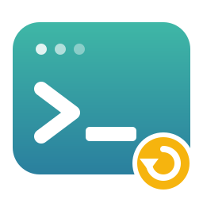
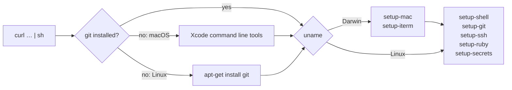

<p align="center">
  
</p>

<h1 align="center">setup</h1>

<p align="center">
  <strong>One line turns a blank machine into mine.</strong><br />
  🍎 macOS &nbsp;·&nbsp; 🐧 Linux &nbsp;·&nbsp; 🔁 safe to re-run
</p>

<p align="center">
  
  
  
  
  
  
</p>

<p align="center">
  
</p>

My dotfiles live in a family of small repos, one job each: shell aliases, git config, ssh defaults, Ruby console setup, a secrets scaffold, and on a Mac, Homebrew and iTerm. This repo is the front door. It's a single script, served by GitHub Pages, that installs git if it's missing, clones every repo and runs each one's installer. There's nothing to download first and no checklist to follow.

## Use it

```sh
(curl -fsSL https://lawrence-berry.github.io/setup || wget -qO- https://lawrence-berry.github.io/setup) | sh
```

macOS has no `wget` and a fresh Ubuntu may have no `curl`, so the `||` covers both. Prefer to read it first? `curl -fsSL https://lawrence-berry.github.io/setup | less`. It's about 50 lines.

Open a new terminal when it finishes.

## What you get

| Repo | What it sets up | 🍎 macOS | 🐧 Linux |
|---|---|:-:|:-:|
| [**setup-mac**](https://github.com/lawrence-berry/setup-mac) | Homebrew and a Brewfile: CLI tools, apps, App Store apps | ✅ | |
| [**setup-iterm**](https://github.com/lawrence-berry/setup-iterm) | iTerm hotkey window, a Karabiner double-tap rule, shell integration | ✅ | |
| [**setup-shell**](https://github.com/lawrence-berry/setup-shell) | Shell aliases, with a per-machine `~/.shell.local` for overrides | ✅ | ✅ |
| [**setup-git**](https://github.com/lawrence-berry/setup-git) | Git aliases and config, included from your own `~/.gitconfig` | ✅ | ✅ |
| [**setup-ssh**](https://github.com/lawrence-berry/setup-ssh) | SSH defaults, included from your own `~/.ssh/config` | ✅ | ✅ |
| [**setup-ruby**](https://github.com/lawrence-berry/setup-ruby) | `.irbrc`, `.pryrc`, `.gemrc` and the console gems they use | ✅ | ✅ |
| [**setup-secrets**](https://github.com/lawrence-berry/setup-secrets) | A `~/.secrets` scaffold, sourced from your shell | ✅ | ✅ |



The macOS-only repos run first, so Homebrew and its tools exist before the shared repos install. Linux gets only the cross-platform five.

## Engineering highlights

- **Safe to re-run.** Existing repos are updated with `git pull --ff-only`. Each installer is idempotent: it checks before it writes, and dotfiles or configs it would replace (Ruby dotfiles, Karabiner) are moved aside as `<name>.bak` first.
- **Nothing of yours is overwritten blindly.** Git and ssh are wired in with `include` lines, so your own `~/.gitconfig` and `~/.ssh/config` stay yours. Secrets are scaffolded once and never touched again.
- **Runs with a missing exec bit.** Installers are run as `sh install.sh`, not `./install.sh`, so one repo missing `chmod +x` can't stop the run. A real bug, found while testing on a clean machine.
- **Plain POSIX `sh`.** No dependencies beyond `curl` or `wget`, so it works on a machine that has nothing yet.
- **Tested on both operating systems, by a robot.** See below.

## Tests

| Where | What it checks | How |
|---|---|---|
| 🐧 `smoke-test.sh` | The live bootstrap on a fresh Ubuntu 24.04, then each of the 5 shared repos left its hook (rc line, git include, ssh include, symlinks, secrets file) | Docker, run by hand: `./smoke-test.sh [url]` |
| 🍎 `smoke-macos` workflow | The same bootstrap on a clean macOS runner, all 7 repos, including Homebrew, iTerm and Karabiner | GitHub Actions: monthly (06:00 UTC on the 1st), on demand, and on PRs that touch `setup` |

The macOS run installs the real Brewfile on a machine that has never seen it. `setup-mac` treats a failed Brewfile entry as a warning, not an error, so a broken cask shows up in the job log but doesn't fail the job. The run can't test the parts that need a screen: Karabiner's permission prompts and iTerm actually loading its settings.

## Roadmap

- **Stop early on a macOS Homebrew no longer supports.** On an unsupported version there are no prebuilt bottles, so every formula compiles from source and the install can take an hour. The macOS run should stop with a clear message first, with an override for anyone who wants to continue.
- **A lean Linux profile.** Linux currently gets the five shared repos. A "live server" mode could be just the aliases and git config, with the Ruby setup opt-in.

<p align="center">
  <br />
  <em>Curl it, pipe it, get on with your day.</em>
</p>
